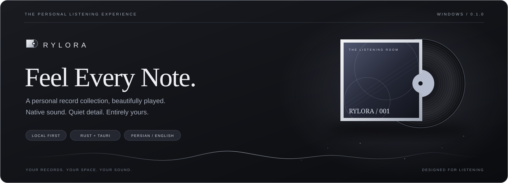
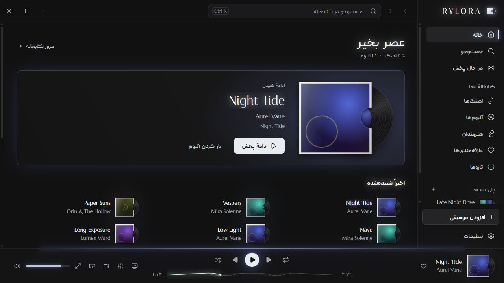

<div align="center">



**موسیقیِ خودت، در فضایی که برای شنیدن ساخته شده.**

پخش بومی با Rust · رابط گرافیتی و نقره‌ای · فارسی و انگلیسی

[**دانلود نسخهٔ ویندوز**](https://github.com/karimialireza405/RYLORA/releases/tag/v0.1.0) &nbsp; · &nbsp; [**شروع استفاده**](#شروع-استفاده) &nbsp; · &nbsp; [**قابلیت‌ها**](#features) &nbsp; · &nbsp; [**معماری**](#معماری) &nbsp; · &nbsp; [**English**](README.md)

<sub>نسخهٔ ۰.۱.۰ · دسکتاپ ویندوز · کتابخانهٔ محلی</sub>

</div>

---

<div dir="rtl">

RYLORA فایل‌های موسیقی روی کامپیوترت را به یک مجموعهٔ شخصی تبدیل می‌کند: آلبوم‌ها با جلد و صفحهٔ وینیل نمایش داده می‌شوند، رنگ کاور به فضای پخش جان می‌دهد و ادامهٔ شنیدن همیشه در دسترس است. فایل‌ها روی سیستم می‌مانند و پخش موسیقی به اینترنت وابسته نیست.

پشت این ظاهر، موتور واقعی پخش با Rust قرار دارد؛ پخش بدون فاصله، تنظیم بلندی صدا، اکولایزر ده‌باندی و تحلیل طیف از خودِ صدای در حال پخش. رابط React نمایش و تعامل را مدیریت می‌کند و مالکیت پخش و کتابخانه در بخش بومی برنامه باقی می‌ماند.

</div>



<div dir="rtl">

> **دربارهٔ تصویر:** این عکس از رابط فعلی در پیش‌نمایش توسعه با فهرست موسیقی خیالی گرفته شده است. تصویر، رابط پیاده‌سازی‌شده را نشان می‌دهد؛ خود پیش‌نمایش مرورگر صدا و دادهٔ FFT واقعی تولید نمی‌کند. برای آزمایش پخش باید نسخهٔ دسکتاپ را اجرا کرد.

<a name="features"></a>

## قابلیت‌ها

| بخش | امکانات پیاده‌سازی‌شده |
| ---: | ---: |
| **پخش** | پخش بدون فاصله، صف قابل ویرایش، تصادفی، تکرار، ادامهٔ نشست قبلی و بازیابی خطاهای پخش. |
| **کنترل صدا** | اکولایزر ده‌باندی با پیش‌تنظیم و پری‌امپ، هم‌سطح‌سازی بلندی آهنگ یا آلبوم، کراس‌فید اختیاری ۱ تا ۱۲ ثانیه و رد کردن سکوت. |
| **کتابخانه** | افزودن فایل یا پوشه، اسکن افزایشی در پس‌زمینه، پایش پوشه‌ها هنگام اجرای برنامه، تشخیص فایل‌های گمشده، مرتب‌سازی و نمای فهرست یا شبکه. |
| **کاور و موشن** | جلد برش‌خورده و وینیل، رنگ‌گیری از کاور، نور ملایم، نبض نرم بر اساس صدا، بازوی گرامافون و نمایش ذرات و طیف. |
| **متن آهنگ** | فایل محلی LRC، متن همگام داخل تگ و متن ساده؛ دنبال کردن پخش و جابه‌جایی با انتخاب سطر همگام. |
| **مجموعهٔ شخصی** | علاقه‌مندی‌ها، پلی‌لیست قابل ویرایش، سنجاق آلبوم، اخیراً شنیده‌شده و بیشترین پخش. |
| **ویندوز** | انتخابگر بومی فایل و پوشه، کشیدن و رها کردن، اجرای تک‌نمونه‌ای، حفظ اندازهٔ پنجره، کلیدهای مدیا و پخش‌کنندهٔ کوچک همیشه‌بالا. |
| **زبان و دسترس‌پذیری** | فارسی پیش‌فرض، انگلیسی، چیدمان راست‌به‌چپ، ارقام فارسی و تاریخ شمسی؛ ناوبری با کیبورد، فوکوس مشخص و تنظیم کاهش حرکت. |

فرمت‌های فعلی شامل **MP3، FLAC، WAV، Ogg Vorbis و AAC/M4A** هستند. Opus در نسخهٔ فعلی پشتیبانی نمی‌شود.

## شروع استفاده

### نصب روی ویندوز

فایل [**نصب RYLORA 0.1.0 برای ویندوز ۶۴بیتی (.exe)**](https://github.com/karimialireza405/RYLORA/releases/download/v0.1.0/RYLORA_0.1.0_x64-setup.exe) در [صفحهٔ ریلیز](https://github.com/karimialireza405/RYLORA/releases/tag/v0.1.0) قرار دارد. فایل `SHA256SUMS.txt` نیز برای بررسی صحت دانلود همراه آن منتشر شده است. چون مخزن خصوصی است، دانلود به حساب گیت‌هاب دارای دسترسی نیاز دارد.

این نسخه امضای Authenticode ندارد و ممکن است ویندوز ناشر آن را ناشناخته نمایش دهد. مراحل بعد برای اجرای برنامه از روی سورس هستند.

### پیش‌نیازهای ویندوز

Node.js همراه npm، ابزار Rust با زنجیرهٔ MSVC، ابزار ساخت Visual Studio با مؤلفهٔ Desktop development with C++ و WebView2 Runtime لازم هستند. مراحل رسمی را در [راهنمای پیش‌نیازهای Tauri](https://v2.tauri.app/start/prerequisites/#windows) ببینید.

محیط توسعهٔ استفاده‌شده ویندوز ۱۱، Node.js 24 و Rust 1.95 است. حداقل Rust در مانیفست 1.82 اعلام شده؛ برای مجموعهٔ وابستگی‌های قفل‌شده از نسخهٔ پایدار روز MSVC استفاده کنید. سیستم‌عامل‌های دیگر هنوز هدف اعتبارسنجی‌شدهٔ پروژه نیستند.

### اجرای برنامه

</div>

```powershell
git clone https://github.com/karimialireza405/RYLORA.git
cd RYLORA
npm ci
npm run app:dev
```

<div dir="rtl">

مخزن خصوصی است و برای دریافت آن به دسترسی حساب گیت‌هاب نیاز دارید. دستور آخر، سرور توسعه و پنجرهٔ بومی برنامه را باز می‌کند.

از نوار کناری **افزودن موسیقی** را انتخاب کنید، کلید `Ctrl + O` را بزنید یا فایل و پوشه را روی پنجره رها کنید. پوشه‌ها همراه زیرپوشه‌ها بررسی می‌شوند. افزودن فایل، پخش فعلی را قطع نمی‌کند؛ برای تغییر آهنگ می‌توانید «پخش اکنون» را انتخاب کنید.

کاور داخل فایل اولویت دارد. در نبود آن، عکس‌هایی مثل `cover.jpg`، `folder.png`، `front.webp` یا تصویر هم‌نام آهنگ می‌توانند استفاده شوند. تغییر زبان از تنظیمات انجام می‌شود.

<details>
<summary><strong>پیش‌نمایش رابط و موسیقی آزمایشی</strong></summary>

برای بررسی ظاهر، `npm run dev` را اجرا کنید و آدرس `http://localhost:1420` را باز کنید. این حالت مخصوص توسعه است، اطلاعات خیالی دارد و صدا یا FFT واقعی تولید نمی‌کند. نسخهٔ تولیدی این بک‌اند را شامل نمی‌شود.

برای تولید موسیقی مصنوعی آزمایشی از `python scripts/generate-test-media.py test-media` استفاده کنید. Python، NumPy، Pillow و FFmpeg لازم هستند. پوشهٔ خروجی را داخل نسخهٔ دسکتاپ وارد کنید؛ این فایل‌ها در Git ثبت نمی‌شوند.

</details>

## معماری

برنامه یک ساختار یکپارچهٔ ماژولار دارد: رابط React داخل WebView2 اجرا می‌شود، Tauri مرز ارتباط با Rust است و SQLite کتابخانه، ترجیحات و سابقهٔ شنیدن را نگه می‌دارد. فرمان‌های تایپ‌شده قصد کاربر را به بک‌اند می‌رسانند و رویدادها وضعیت را برمی‌گردانند.

| لایه | مسئولیت |
| ---: | ---: |
| **رابط** | React، TypeScript، Tailwind CSS، Radix UI و Motion؛ صفحه‌ها، کنترل‌ها، راست‌به‌چپ و جلوه‌های بصری. |
| **وضعیت** | Zustand؛ نمای وضعیت بک‌اند، ناوبری و تنظیمات، با وضعیت پیشرفت پخش مجزا. |
| **مرز بومی** | Tauri 2؛ فرمان و رویداد، چرخهٔ پنجره و پروتکل کاور محلی. |
| **پخش** | Rust، rodio و Symphonia؛ صف، رمزگشایی، پردازش صدا و خروجی. |
| **کتابخانه** | Lofty، notify، image، BLAKE3 و rusqlite؛ تگ، پایش پوشه، کش کاور و ذخیره‌سازی. |

<details>
<summary><strong>جزئیات تخصصی موتور صدا</strong></summary>

یک عامل اختصاصی، فرمان‌های پخش را به‌ترتیب اجرا می‌کند و مالک صف است. مسیر صدای بومی مستقل از React اجرا می‌شود. پیشرفت پخش در یک استور جداگانه تقریباً چهار بار در ثانیه به‌روز می‌شود و دادهٔ طیف خارج از وضعیت کامپوننت‌های React جریان دارد.

موتور برای پخش بدون فاصله، آهنگ بعدی را آماده می‌کند و جریان خروجی را پیوسته نگه می‌دارد. کراس‌فید اختیاری از ترکیب با توان برابر استفاده می‌کند؛ آهنگ‌های متوالی یک آلبوم به‌صورت پیش‌فرض فاصلهٔ مصنوعی نمی‌گیرند.

اکولایزر شامل ده باند در فرکانس‌های ۳۱، ۶۲، ۱۲۵، ۲۵۰، ۵۰۰ هرتز و ۱، ۲، ۴، ۸ و ۱۶ کیلوهرتز است. خروجی از مسیر اشتراکی ویندوز استفاده می‌کند؛ WASAPI انحصاری و خروجی bit-perfect پیاده‌سازی نشده‌اند.

هم‌سطح‌سازی، تگ ReplayGain را ترجیح می‌دهد و در نبود آن تحلیل محلی EBU R128 انجام می‌دهد. هدف حالت‌های آرام، عادی و بلند به‌ترتیب ۲۳−، ۱۴− و ۱۱− LUFS است. تغییر بهره نرم است و با پیک نمونه محدود می‌شود؛ لیمیتر و تضمین true-peak وجود ندارد. در نبود تگ آلبوم، تخمین انرژی با وزن مدت آهنگ‌ها استفاده می‌شود.

طیف ۶۴‌باندی از نمونه‌های واقعی صدا به دست می‌آید. حرکت کاور پاسخ صوتی هموارشده دارد و رنگ کاور به جلوه‌ها منتقل می‌شود. انتخاب دستگاه خروجی ذخیره می‌شود و حالت System Default از دستگاه پیش‌فرض ویندوز پیروی می‌کند.

</details>

<details>
<summary><strong>یکپارچگی کتابخانه و داده‌ها</strong></summary>

شناسهٔ مسیر استانداردشده به حفظ سابقه، علاقه‌مندی و عضویت در پلی‌لیست هنگام اسکن مجدد کمک می‌کند. اسکن پس‌زمینه اتصال مستقل پایگاه داده دارد؛ SQLite از WAL و مهاجرت‌های نسخه‌دار استفاده می‌کند. فایل گمشده علامت می‌خورد و سابقهٔ آن بی‌صدا حذف نمی‌شود.

ویرایش تگ پیش‌فرض فقط داخل کتابخانه است. نوشتن روی فایل نیاز به انتخاب صریح دارد و از کپی کنار فایل و بررسی آن پیش از جایگزینی استفاده می‌کند. مشتق‌های کاور در اندازه‌های ۶۴۰ و ۱۹۲ پیکسل با آدرس مبتنی بر BLAKE3 کش می‌شوند. سرویس آنلاین دریافت متن آهنگ وجود ندارد.

</details>

نمودار کامل و نقشهٔ پوشه‌ها در [README انگلیسی](README.md#architecture) و قواعد مالکیت وضعیت در [سند معماری](docs/architecture/overview.md) آمده است.

## توسعه و ساخت

</div>

```powershell
npm run typecheck
npm test
cargo test --manifest-path src-tauri/Cargo.toml
cargo clippy --manifest-path src-tauri/Cargo.toml --all-targets
npm run build

# Windows installers
npm run app:build
# NSIS only
npm run tauri -- build --bundles nsis
```

<div dir="rtl">

خروجی نصب‌کننده‌ها زیر `src-tauri/target/release/bundle/` قرار می‌گیرد؛ پوشه‌های NSIS و MSI به‌ترتیب `nsis/` و `msi/` هستند. ساخت موفق رابط وب جای آزمایش پخش بومی با فایل و دستگاه واقعی را نمی‌گیرد.

خط ارتباط بومی را در `src/services/backend` نگه دارید، مالکیت پخش را به Rust بسپارید و متن فارسی، لاتین و ترکیبی را بررسی کنید. قواعد ظاهر در [سیستم طراحی](docs/design-system/overview.md) ثبت شده‌اند.

### وضعیت انتشار

ساخت NSIS/MSI، هوک امضای ویندوز و بررسی امضای آپدیت پیاده‌سازی شده‌اند. **آدرس سرویس آپدیت در تنظیمات فعلی ثبت نشده است.** امضای معتبر ویندوز به گواهی یا سرویس امضای جداگانه نیاز دارد. اسکریپت انتشار فایل‌ها را آماده می‌کند و خودش آن‌ها را آپلود نمی‌کند. جزئیات در [راهنمای انتشار](docs/development/releasing.md) آمده است.

## میانبرها

| کار | کلید |
| ---: | ---: |
| پخش / توقف | `Space` |
| بعدی / قبلی | `Ctrl + → / ←` |
| جابه‌جایی در آهنگ | `Shift + → / ←` |
| بلندی صدا | `Ctrl + ↑ / ↓` |
| افزودن موسیقی | `Ctrl + O` |
| جست‌وجو | `Ctrl + K` یا `/` |
| صف پخش | `Q` |
| علاقه‌مندی | `Ctrl + L` |
| حالت سینمایی | `F11` |
| تمام میانبرها | `?` |

در حالت سینمایی، `F` تمام‌صفحه، `L` متن آهنگ و `Esc` خروج است. این‌ها میانبرهای داخل برنامه هستند؛ کلیدهای مدیای ویندوز مسیر بومی جداگانه دارند.

## حریم خصوصی و محل داده‌ها

موسیقی در محل اصلی خود می‌ماند. پایگاه دادهٔ `rylora.db` و کش کاورها در پوشهٔ دادهٔ برنامه، معمولاً `%APPDATA%\app.rylora.player\`، ذخیره می‌شوند. پخش اصلی به حساب کاربری، آپلود موسیقی یا کاتالوگ آنلاین نیاز ندارد و یکپارچه‌سازی تله‌متری وجود ندارد. ارتباط شبکه مربوط به جریان آپدیت است؛ آن هم پس از تنظیم آدرس و بررسی درخواستی یا فعال‌شده از سوی کاربر.

## مستندات و مجوزها

- [معماری](docs/architecture/overview.md): مالکیت وضعیت، تردها، IPC و پایگاه داده.
- [سیستم طراحی](docs/design-system/overview.md): تایپوگرافی، رنگ، کنترل‌ها و موشن.
- [راه‌اندازی توسعه](docs/development/setup.md): ابزارها و اجرای محلی.
- [انتشار](docs/development/releasing.md): نصب‌کننده، امضا و آپدیت.
- [نقشهٔ راه](docs/development/roadmap.md): کارهای انجام‌شده، باقی‌مانده و شواهد اعتبارسنجی.

این پروژه در حال توسعه و مخزن آن خصوصی است. سرویس استریم، همگام‌سازی ابری، خروجی WASAPI انحصاری و سرویس میزبانی آپدیت جزو پیکربندی تحویل‌شدهٔ فعلی نیستند.

مجوز متن‌باز سراسری برای پروژه اضافه نشده است. هر وابستگی مجوز خودش را دارد. مجوزهای OFL فونت‌های [Italiana](docs/design-system/Italiana-OFL.txt) و [Marcellus](docs/design-system/Marcellus-OFL.txt) همراه پروژه هستند. Peyda اختصاصی است؛ پیش از بازتوزیع فونت، [اعلان مجوز موجود](src/assets/fonts/peyda/FontLicense.txt) و حق توزیع آن را بررسی کنید.

</div>

---

<p align="center"><strong>RYLORA</strong><br /><sub>مجموعهٔ تو. فضای تو. صدای تو.</sub></p>

<p align="center">طراحی و ساخت: <a href="https://github.com/karimialireza405"><strong>علیرضا کریمی</strong></a></p>
