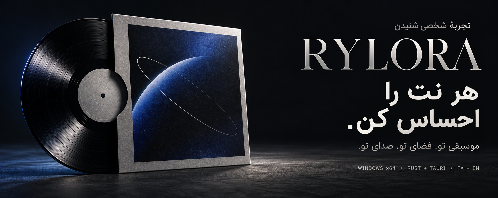

<div dir="rtl" align="center">

[](https://github.com/karimialireza405/RYLORA/releases/latest)

# موسیقی تو؛ با حال‌وهوای خودت.

**ریلورا، فضای شخصی شنیدن موسیقی‌هایی است که خودت داری.**

رابطی با حس صفحهٔ وینیل، موتور صدای بومی Rust و کتابخانه‌ای که پیش خودت می‌ماند.

[](https://github.com/karimialireza405/RYLORA/releases/tag/v0.1.0) [](https://github.com/karimialireza405/RYLORA/releases/latest) [](#native-engine) [](README.md)

**فارسی** &nbsp; / &nbsp; [**English**](README.md)

[](https://github.com/karimialireza405/RYLORA/releases/download/v0.1.0/RYLORA_0.1.0_x64-setup.exe)

[صفحهٔ انتشار](https://github.com/karimialireza405/RYLORA/releases/tag/v0.1.0) &nbsp; · &nbsp; [تماشای رابط](#listening-room) &nbsp; · &nbsp; [اجرا از سورس](#development)

<sub>ویندوز ۶۴ بیتی · کتابخانهٔ محلی موسیقی · بدون نیاز به حساب برای شنیدن</sub>

</div>

---

<div dir="rtl">

<a name="listening-room"></a>

## جایی برای نشستن و شنیدن

بعضی آلبوم‌ها چیزی بیشتر از یک نام در فهرست فایل‌ها هستند. ریلورا پوشهٔ موسیقی تو را به یک مجموعهٔ شخصی تبدیل می‌کند: جلدهایی که می‌شناسی، جایی برای ادامهٔ شنیدن و پخش‌کننده‌ای که حال‌وهوایش را از کاور آهنگ می‌گیرد.

فایل‌هایت را اضافه کن، یک آلبوم انتخاب کن و به موسیقی برگرد. شنیدن آفلاین کار می‌کند و موسیقی روی کامپیوتر خودت می‌ماند.


<p align="center"><sub>در حال پخش / یک جلد، یک صفحه و فضایی برای موسیقی.</sub></p>

> **دربارهٔ تصاویر:** گالری، رابط پیاده‌سازی‌شده را در پیش‌نمایش توسعه با فهرست موسیقی خیالی نشان می‌دهد. پیش‌نمایش مرورگر صدا و FFT واقعی تولید نمی‌کند؛ پخش و واکنش واقعی به صدا به برنامهٔ دسکتاپ نیاز دارند. بنر اصلی یک تصویر هنری اختصاصی برای معرفی برند است. [منبع تصاویر و پرامپت‌ها ←](docs/readme/README.md)

## مجموعهٔ تو، حال‌وهوای تو


<p align="center"><sub>خانه / به آلبومی برگرد که هنوز تمام نشده است.</sub></p>


<p align="center"><sub>کتابخانه / آلبوم‌ها، هنرمندها و موسیقی‌هایی که برای نگه‌داشتن انتخاب کرده‌ای.</sub></p>

## تفاوت در جزئیات است

| برای مجموعه‌ات | برای شنیدن |
| ---: | ---: |
| **فایل و پوشه.** افزودن زیرپوشه‌ها، اسکن پس‌زمینه و پایش پوشه‌ها هنگام اجرای برنامه. | **آلبوم، بدون وقفهٔ مصنوعی.** پخش بدون فاصله، صف قابل ویرایش، پخش تصادفی، تکرار و ادامهٔ نشست قبلی. |
| **کاوری با حضور واقعی.** عکس داخل فایل و تصویر محلی به جلد وینیل، بندانگشتی کش‌شده و رنگ پخش‌کننده تبدیل می‌شوند. | **صدایی که شکلش می‌دهی.** اکولایزر ده‌باندی، پیش‌تنظیم‌ها، پری‌امپ و ذخیرهٔ دستگاه خروجی. |
| **کتابخانه‌ای که یادش می‌ماند.** علاقه‌مندی‌ها، پلی‌لیست، سنجاق آلبوم، تعداد پخش و سابقهٔ شنیدن. | **بلندی صدای هماهنگ‌تر.** هم‌سطح‌سازی آهنگ یا آلبوم با تگ ReplayGain یا تحلیل محلی EBU R128. |
| **متنی که همراه آهنگ می‌آید.** LRC محلی، متن همگام داخل فایل، متن ساده و رفتن به زمان سطرهای همگام. | **گذار با انتخاب خودت.** کراس‌فید اختیاری ۱ تا ۱۲ ثانیه و رد کردن سکوت؛ آهنگ‌های متوالی آلبوم به‌صورت پیش‌فرض بدون فاصله می‌مانند. |
| **فارسی، با دقت.** راست‌به‌چپ، ارقام فارسی، تاریخ شمسی و دسترسی به رابط انگلیسی از تنظیمات. | **پخش، با حال‌وهوای کاور.** طیف بومی ۶۴‌باندی، رنگ و حرکت برگرفته از کاور، نمای سینمایی و پخش‌کنندهٔ کوچک. |

**فرمت‌های قابل استفاده:** `MP3` · `FLAC` · `WAV` · `Ogg Vorbis` · `AAC / M4A`

<details>
<summary><strong>جزئیات ویندوز و میان‌برها</strong></summary>

انتخابگر بومی فایل و پوشه، کشیدن و رها کردن، اجرای تک‌نمونه‌ای، حفظ اندازهٔ پنجره، کلیدهای مدیای ویندوز، پخش‌کنندهٔ کوچک همیشه‌بالا، فوکوس مشخص کیبورد و پشتیبانی از کاهش حرکت پیاده‌سازی شده‌اند.

| کار | میان‌بر |
| ---: | ---: |
| پخش یا توقف | `Space` |
| بعدی یا قبلی | `Ctrl + → / ←` |
| جابه‌جایی در آهنگ | `Shift + → / ←` |
| بلندی صدا | `Ctrl + ↑ / ↓` |
| افزودن موسیقی | `Ctrl + O` |
| جست‌وجو | `Ctrl + K` یا `/` |
| صف پخش | `Q` |
| علاقه‌مندی | `Ctrl + L` |
| تصادفی یا تکرار | `S` / `R` |
| حالت سینمایی | `F11` |
| تنظیمات | `Ctrl + ,` |
| همهٔ میان‌برها | `?` |

در نمای سینمایی، `F` تمام‌صفحه، `L` متن آهنگ و `Esc` خروج است. کلیدهای مدیای ویندوز از مسیر بومی جلسهٔ پخش استفاده می‌کنند.

</details>

## اولین بار که گوش می‌دهی

۱. **ریلورا را نصب کن.** [فایل نصب ویندوز ۶۴ بیتی](https://github.com/karimialireza405/RYLORA/releases/download/v0.1.0/RYLORA_0.1.0_x64-setup.exe) را دریافت کن و مراحل نصب را انجام بده.

۲. **مجموعه‌ات را بیاور.** «افزودن موسیقی» را بزن، از `Ctrl + O` استفاده کن یا فایل و پوشه را روی پنجره رها کن. زیرپوشه‌ها هم بررسی می‌شوند.

۳. **به سلیقهٔ خودت گوش بده.** آلبوم را انتخاب کن، دستگاه خروجی یا اکولایزر را تغییر بده و زبان را از تنظیمات انتخاب کن.

افزودن فایل، پخش فعلی را قطع نمی‌کند. وقتی بخواهی به انتخاب تازه بروی، «پخش اکنون» را بزن.

| دانلود | جزئیات |
| ---: | ---: |
| [**فایل نصب RYLORA 0.1.0**](https://github.com/karimialireza405/RYLORA/releases/download/v0.1.0/RYLORA_0.1.0_x64-setup.exe) | ویندوز ۶۴ بیتی؛ حدود ۵٫۷۱ مگابایت دودویی |
| [**صفحهٔ انتشار**](https://github.com/karimialireza405/RYLORA/releases/tag/v0.1.0) | فایل نصب و اطلاعات نسخه |
| [**فایل SHA256SUMS.txt**](https://github.com/karimialireza405/RYLORA/releases/download/v0.1.0/SHA256SUMS.txt) | بررسی یکپارچگی فایل دانلودشده |

**یادداشت نصب:** فایل نصب امضای دیجیتال ندارد و ممکن است ویندوز هشدار ناشر ناشناس نشان بدهد. هش دانلود را با فایل هش همان انتشار مقایسه کن. ویندوز ۱۱ محیط ثبت‌شدهٔ توسعه و اعتبارسنجی است. این مخزن عمومی است و دانلود به دعوت‌نامهٔ دسترسی نیاز ندارد.

</div>

```powershell
Get-FileHash .\RYLORA_0.1.0_x64-setup.exe -Algorithm SHA256
```

<div dir="rtl">

<a name="native-engine"></a>

## بخش اصلی صدا، بومی اجرا می‌شود

React مجموعه را نمایش می‌دهد و Rust پخش را در اختیار دارد. یک عامل اختصاصی، فرمان‌ها را به‌ترتیب اجرا می‌کند و صف، گذار آهنگ‌ها و ساعت پخش را بیرون از رابط نگه می‌دارد. SQLite هم کتابخانه و سابقهٔ شنیدن را ذخیره می‌کند.

| لایه | مسئولیت |
| ---: | ---: |
| **React و TypeScript** | صفحه‌ها، کنترل‌ها، جلوه‌ها و چیدمان فارسی |
| **Tauri 2** | فرمان‌ها و رویدادهای تایپ‌شده و ارتباط رابط با برنامهٔ بومی |
| **Rust** | صف، رمزگشایی، خروجی صدا، پردازش، طیف و گذارها |
| **سرویس کتابخانه** | اسکن، تگ، کاور و پایش پوشه |
| **SQLite** | کتابخانه، ترجیحات، پلی‌لیست و سابقه |

<details>
<summary><strong>زیر سوزن: موتور صدا و جزئیات فنی</strong></summary>

- **بدون فاصله:** آهنگ بعدی پیش از گذار آماده می‌شود؛ تأخیر و حاشیهٔ رمزگذار مدیریت می‌شود و خروجی پیوسته می‌ماند. کراس‌فید از ترکیب با توان برابر استفاده می‌کند.
- **اکولایزر:** ده باند در ۳۱، ۶۲، ۱۲۵، ۲۵۰، ۵۰۰ هرتز و ۱، ۲، ۴، ۸ و ۱۶ کیلوهرتز، همراه پری‌امپ و پیش‌تنظیم.
- **هم‌سطح‌سازی:** اولویت با ReplayGain است و در نبود آن تحلیل محلی EBU R128 انجام می‌شود. هدف حالت‌های آرام، عادی و بلند به‌ترتیب ۲۳−، ۱۴− و ۱۱− LUFS است. بهره نرم تغییر می‌کند و با پیک نمونه محدود می‌شود؛ لیمیتر و تضمین true-peak وجود ندارد. بدون تگ آلبوم، تخمین انرژی با وزن مدت استفاده می‌شود.
- **خروجی:** مسیر اشتراکی ویندوز و تعویض دستگاه خروجی. WASAPI انحصاری و خروجی bit-perfect پیاده‌سازی نشده‌اند.
- **جلوه‌ها:** FFT بومی، طیف ۶۴‌باندی و واکنش هموار کاور را تغذیه می‌کند. کاور منبع رنگ است. نوار جابه‌جایی یک کنترل واکنشی است و شکل موج رمزگشایی‌شدهٔ کل آهنگ نیست. تنظیم کاهش حرکت رعایت می‌شود.
- **جداسازی:** پخش مستقل از React اجرا می‌شود. پیشرفت در استوری جدا تقریباً چهار بار در ثانیه به‌روز می‌شود و دادهٔ طیف از وضعیت کامپوننت‌های React جداست.

مالکیت وضعیت، تردها و پردازش صدا در [سند معماری](docs/architecture/overview.md) توضیح داده شده‌اند؛ نمودار کامل هم در [نسخهٔ انگلیسی](README.md#native-where-it-matters) است.

</details>

<details>
<summary><strong>کتابخانه‌ای که سابقه‌اش را نگه می‌دارد</strong></summary>

کلید مسیر استانداردشده هویت آهنگ را در اسکن مجدد حفظ می‌کند. پایگاه داده WAL و مهاجرت نسخه‌دار دارد؛ اسکن با اتصال جداگانه در پس‌زمینه انجام می‌شود. فایل گمشده علامت می‌خورد و سابقه‌اش بی‌صدا حذف نمی‌شود.

ویرایش تگ، پیش‌فرض فقط داخل کتابخانه است. نوشتن روی فایل اصلی به انتخاب صریح نیاز دارد و با کپیِ بررسی‌شده کنار فایل انجام می‌شود. کاور داخل فایل اولویت دارد؛ سپس عکس‌هایی مثل `cover.jpg`، `folder.png`، `front.webp` یا تصویر هم‌نام آهنگ بررسی می‌شوند. نسخه‌های ۶۴۰ و ۱۹۲ پیکسلی با آدرس مبتنی بر BLAKE3 کش می‌شوند.

پایش پوشه هنگام باز بودن برنامه اجرا می‌شود؛ اسکن بعدی تغییرات زمان بسته بودن را تطبیق می‌دهد. متن آهنگ محلی است و سرویس آنلاین دریافت متن وجود ندارد.

</details>

<a name="development"></a>

## ساخت و بررسی پروژه

ابزارهای ثبت‌شده برای توسعهٔ ویندوز شامل **Node.js 24**، **Rust/MSVC**، ابزار ساخت Visual Studio با مؤلفهٔ C++ و **WebView2 Runtime** هستند. مانیفست، حداقل Rust را 1.82 اعلام می‌کند و محیط توسعهٔ ثبت‌شده از Rust 1.95 استفاده کرده است. [راهنمای راه‌اندازی](docs/development/setup.md) جزئیات را توضیح می‌دهد.

</div>

```powershell
git clone https://github.com/karimialireza405/RYLORA.git
cd RYLORA
npm ci
npm run app:dev
```

<div dir="rtl">

| کار | دستور |
| ---: | ---: |
| بررسی نوع‌ها | `npm run typecheck` |
| آزمون رابط | `npm test` |
| آزمون Rust | `cargo test --manifest-path src-tauri/Cargo.toml` |
| بررسی Rust | `cargo clippy --manifest-path src-tauri/Cargo.toml --all-targets` |
| ساخت رابط تولیدی | `npm run build` |
| ساخت نصب‌کننده | `npm run app:build` |
| فقط نصب‌کننده NSIS | `npm run tauri -- build --bundles nsis` |

خروجی زیر `src-tauri/target/release/bundle/` قرار می‌گیرد. ساخت رابط، سازگاری پخش با دستگاه واقعی را تأیید نمی‌کند. جزئیات بسته‌بندی، امضا و آپدیت در [راهنمای انتشار](docs/development/releasing.md) است.

<details>
<summary><strong>پیش‌نمایش رابط، موسیقی آزمایشی و نقشهٔ سورس</strong></summary>

دستور `npm run dev` پیش‌نمایش مخصوص توسعه را در `http://localhost:1420` اجرا می‌کند. فهرست آهنگ و کاورها خیالی‌اند؛ **رمزگشایی، پخش صدا و FFT واقعی ندارد.** این بک‌اند در خروجی تولیدی قرار نمی‌گیرد.

برای ساخت موسیقی مصنوعی آزمایشی، `python scripts/generate-test-media.py test-media` را اجرا کن. Python، NumPy، Pillow و FFmpeg لازم هستند. پوشهٔ خروجی را داخل برنامهٔ دسکتاپ وارد کن.

| مسیر | نقش |
| ---: | ---: |
| `src/app/` | پوسته و مسیریابی |
| `src/features/` | صفحه‌های کتابخانه، پخش و تنظیمات |
| `src/components/` | کنترل‌ها، کاورها و جلوه‌ها |
| `src/services/backend/` | رابط تایپ‌شدهٔ بومی و پیش‌نمایش |
| `src/stores/` | وضعیت رابط و نمای بک‌اند |
| `src-tauri/src/audio/` | رمزگشایی، پردازش، طیف و خروجی |
| `src-tauri/src/application/` | سرویس‌های پخش و کتابخانه |
| `src-tauri/src/library/` | اسکن و پایش مسیرها |
| `src-tauri/src/metadata/` | تگ، کاور و رنگ |
| `src-tauri/src/database/` | ذخیره‌سازی و مهاجرت‌ها |
| `scripts/` و `docs/` | ابزارها، انتشار و مستندات |

فراخوانی بومی را پشت سرویس backend نگه دار، مالکیت پخش را به Rust بسپار و متن فارسی، لاتین و ترکیبی را بررسی کن.

</details>

## فایل‌هایت پیش خودت می‌مانند

شنیدن به حساب، آپلود یا کاتالوگ آنلاین نیاز ندارد و یکپارچه‌سازی تله‌متری وجود ندارد. موسیقی در محل اصلی می‌ماند؛ فهرست کتابخانه، پلی‌لیست‌ها، ترجیحات، سابقه و کش کاورها معمولاً در `%APPDATA%\app.rylora.player\` ذخیره می‌شوند.

ارتباط شبکه مربوط به جریان آپدیت است، وقتی تنظیم شده و کاربر آن را فعال یا درخواست کرده باشد. **در تنظیمات فعلی، آدرس سرویس میزبانی آپدیت ثبت نشده و نصب و به‌روزرسانی این انتشار دستی است.**

## یادداشت‌های کنار جلد

| راهنما | محتوا |
| ---: | ---: |
| [معماری](docs/architecture/overview.md) | مالکیت پخش، تردها، IPC، ذخیره‌سازی و موتور صدا |
| [سیستم طراحی](docs/design-system/overview.md) | تایپوگرافی، سطوح، کاور، رنگ، حرکت و تعامل |
| [راه‌اندازی توسعه](docs/development/setup.md) | ابزارها، اجرای محلی، موسیقی آزمایشی و بررسی‌های ثبت‌شده |
| [انتشار](docs/development/releasing.md) | نصب‌کننده، امضا، آپدیت و توزیع |
| [نقشهٔ راه](docs/development/roadmap.md) | رفتار پیاده‌سازی‌شده، شواهد اعتبارسنجی و کارهای باقی‌مانده |

<details>
<summary><strong>محدودهٔ پروژه، فرمت‌ها و مجوزها</strong></summary>

ریلورا 0.1.0 یک برنامهٔ ویندوزی در حال توسعه است. سرویس استریم، همگام‌سازی ابری، خروجی انحصاری صدا و سرویس میزبانی آپدیت جزو پیکربندی فعلی نیستند. Opus و جریان‌های زنجیره‌ای Ogg با تغییر نرخ نمونه وسط فایل پشتیبانی نمی‌شوند.

مخزن سورس عمومی است. **مجوز متن‌باز سراسری برای پروژه اضافه نشده** و عمومی بودن مخزن به‌معنای داشتن مجوز بازتوزیع نیست. هر وابستگی مجوز خودش را دارد. [Italiana](docs/design-system/Italiana-OFL.txt) و [Marcellus](docs/design-system/Marcellus-OFL.txt) اعلان OFL دارند و وزیرمتن هم مجوز OFL بالادستی دارد. Peyda اختصاصی است؛ شرایط بازتوزیع در [اعلان همراه فونت](src/assets/fonts/peyda/FontLicense.txt) آمده است.

منبع گالری و بنرها در [راهنمای تصاویر README](docs/readme/README.md) ثبت شده است. بنرها تصویر هنری هستند و سخت‌افزاری همراه برنامه عرضه نمی‌شود.

</details>

</div>

---

<div dir="rtl" align="center">


### RYLORA

*هر نت را احساس کن.*

**طراحی و توسعه: [علیرضا کریمی](https://github.com/karimialireza405)**

<sub>مجموعهٔ تو. فضای تو. صدای تو.</sub>

[دریافت ریلورا](https://github.com/karimialireza405/RYLORA/releases/latest) &nbsp; · &nbsp; [English](README.md) &nbsp; · &nbsp; [گیت‌هاب سازنده](https://github.com/karimialireza405)

</div>
