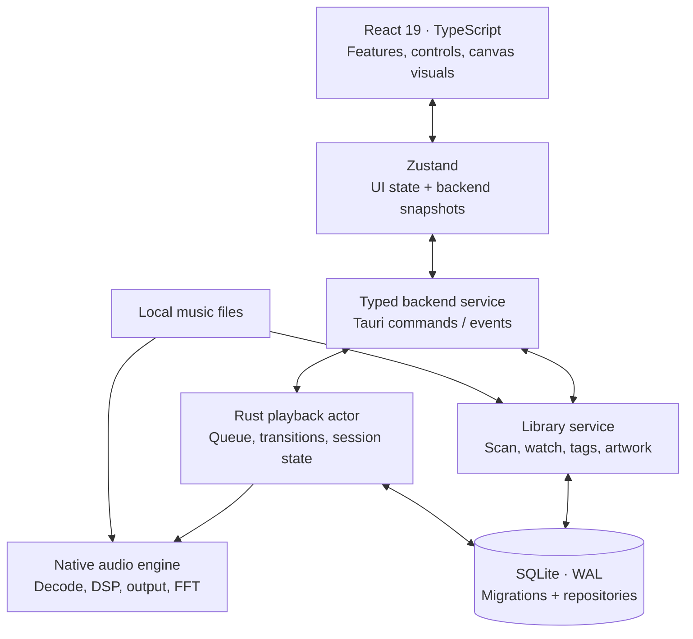

<div align="center">


**A desktop music player built around the music you own.**

Native Rust playback · An artwork-led interface · Persian & English

[**Download for Windows**](https://github.com/karimialireza405/RYLORA/releases/tag/v0.1.0) &nbsp; · &nbsp; [**Get started**](#get-started) &nbsp; · &nbsp; [**The interface**](#the-interface) &nbsp; · &nbsp; [**Architecture**](#architecture) &nbsp; · &nbsp; [**فارسی**](README.fa.md)

<sub>WINDOWS DESKTOP &nbsp; / &nbsp; LOCAL LIBRARY &nbsp; / &nbsp; VERSION 0.1.0</sub>

</div>

---

RYLORA turns a folder of music into a personal record collection. Browse sleeves and vinyl, return to an unfinished album, shape the sound, and let the artwork set the atmosphere. Your files stay on your computer; the listening experience works offline.

The interface is backed by a real audio engine: gapless playback, loudness normalization, a ten-band equalizer, device switching, and a spectrum computed from the audio being played. React handles the presentation; Rust owns playback and the library.

## The interface


<p align="center"><sub>NOW PLAYING — a record sleeve, a moving tonearm, and room for the music.</sub></p>

<table>
<tr>
<td width="50%"></td>
<td width="50%"></td>
</tr>
<tr>
<td><strong>A quieter home.</strong><br />Continue listening, revisit recent plays, and find the records you return to.</td>
<td><strong>A collection with character.</strong><br />Albums, artists, playlists and search, with artwork at the centre.</td>
</tr>
</table>

> **About these images:** captured from the current development browser preview with its fictional catalogue. They show the implemented interface, not a design mockup. The preview produces no audio or live FFT data; those require the native desktop app. [View the Persian interface →](docs/readme/home-fa.jpg)

## Built for listening

<table>
<tr>
<td width="33%" valign="top"><h3>01 / Your collection</h3>Import files or entire folders. Keep albums, artists, favourites, playlists and listening history together. Folder watching keeps the index current while the app is open.</td>
<td width="33%" valign="top"><h3>02 / Your sound</h3>Gapless albums, optional crossfade, ReplayGain or on-device loudness analysis, a ten-band EQ, and a choice of output device.</td>
<td width="33%" valign="top"><h3>03 / Your atmosphere</h3>Cover-derived colour, restrained glow, audio-reactive sleeve motion, a particle spectrum, synced lyrics and an immersive player.</td>
</tr>
</table>

| Area | What is implemented |
| :--- | :--- |
| **Playback** | Editable queue, shuffle, repeat, session resume, gapless transitions and playback error recovery. |
| **Audio controls** | Ten-band EQ with presets and preamp; track/album loudness normalization; optional 1–12 second crossfade and silence skipping. |
| **Local library** | Incremental background scanning, folder watching, missing-file tracking, persisted sorting, grid/list views and search across songs, albums, artists and playlists. |
| **Artwork** | Embedded covers, local sidecar images, cached thumbnails, die-cut sleeves and vinyl. The active cover can colour the player and timeline. |
| **Lyrics** | Local `.lrc`, embedded synchronized lyrics and plain text. Follow playback or click a synchronized line to seek. |
| **Organization** | Favourites, editable playlists, album pins, recent plays and most-played records. |
| **Desktop** | Native file/folder pickers, drag and drop, single instance, remembered window geometry, Windows media keys and media flyout, and an always-on-top mini player. |
| **Language & interaction** | Persian by default, English on demand, RTL layout, Persian digits and Solar Hijri dates; keyboard navigation, visible focus and reduced-motion support. |

### Formats

| Format | Typical extension | Notes |
| :--- | :--- | :--- |
| MP3 | `.mp3` | Lossy audio; encoder padding is handled for gapless playback. |
| FLAC | `.flac` | Lossless audio and embedded metadata/artwork. |
| WAV | `.wav` | PCM audio. |
| Ogg Vorbis | `.ogg` | Vorbis decoding; Opus is not currently supported. |
| AAC | `.m4a`, `.aac` | AAC audio, including M4A containers. |

## Get started

### Install on Windows

Download [**RYLORA 0.1.0 — Windows x64 installer (.exe)**](https://github.com/karimialireza405/RYLORA/releases/download/v0.1.0/RYLORA_0.1.0_x64-setup.exe) from the [release page](https://github.com/karimialireza405/RYLORA/releases/tag/v0.1.0). `SHA256SUMS.txt` is included with the release for download-integrity verification. Access requires a GitHub account with permission to this private repository.

This build is not Authenticode-signed, so Windows may display an unrecognized-publisher warning. The following steps are for building and running the app from source.

### 1. Prepare Windows

Install **Node.js with npm**, **Rust with the MSVC toolchain**, **Visual Studio Build Tools with Desktop development with C++**, and **Microsoft Edge WebView2 Runtime**. Follow the [official Tauri Windows prerequisites](https://v2.tauri.app/start/prerequisites/#windows) for the native toolchain.

Development has been exercised on Windows 11 with Node.js 24 and Rust 1.95. The Rust manifest declares a minimum version of 1.82; use a current stable MSVC toolchain to build the locked dependency set. Other operating systems are not currently validated targets.

### 2. Run the desktop app

```powershell
git clone https://github.com/karimialireza405/RYLORA.git
cd RYLORA
npm ci
npm run app:dev
```

This repository is private; cloning requires access through your GitHub account. The development command starts Vite and opens the native Tauri window.

### 3. Add your music

Choose **Add music** in the sidebar, press **Ctrl + O**, or drop files/folders onto the window. Folder imports include subfolders. Importing keeps existing playback running; use **Play now** when you want to switch to the new selection.

Embedded artwork takes priority. A local `cover.jpg`, `folder.png`, `front.webp`, or image sharing the song's filename can supply a missing cover. Choose **Settings → Language** to switch between Persian and English.

<details>
<summary><strong>Interface-only preview and a generated test library</strong></summary>

For layout work without starting Rust:

```powershell
npm run dev
```

Open `http://localhost:1420`. This development-only backend supplies fictional tracks and deterministic artwork. **It does not decode or play audio, and it emits no real spectrum data.** Production builds exclude this backend and require the desktop shell.

To exercise the native player with original synthesized test media:

```powershell
python scripts/generate-test-media.py test-media
```

The generator requires Python, NumPy, Pillow and FFmpeg. Import the resulting `test-media` folder into the desktop app. Generated media is ignored by Git.

</details>

## Architecture

RYLORA is a **modular monolith**: a Tauri desktop shell hosts a React/WebView2 interface and a Rust backend. Typed commands carry user intent; events carry state back to the interface. SQLite is the durable source for the library, preferences and listening data.



| Layer | Responsibility | Principal tools |
| :--- | :--- | :--- |
| **Presentation** | Feature screens, record artwork, controls, motion and RTL layout | React, TypeScript, Tailwind CSS, Radix UI, Motion, Lucide |
| **Frontend state** | Library snapshots, navigation, preferences and isolated playback progress | Zustand, TanStack Virtual |
| **Desktop boundary** | Validated IPC, window lifecycle, local artwork protocol and native integration | Tauri 2, WebView2 |
| **Playback** | Ordered commands, queue ownership, decoding, output and DSP | Rust, rodio, Symphonia, crossbeam-channel |
| **Library & storage** | Metadata, cover extraction, incremental indexing and migrations | Lofty, image, BLAKE3, notify, rusqlite |

<details>
<summary><strong>Playback engineering: transitions, DSP and visual telemetry</strong></summary>

**Ownership and timing.** A dedicated player actor serializes playback commands and owns the queue. Native rendering runs independently of React. A separate frontend progress store receives approximately four updates per second; spectrum data travels outside React component state so visual activity does not require rerendering the entire interface.

**Gapless playback.** The engine prepares the next track and retains a continuous output stream. It handles encoder delay/padding and repeat-one transitions. Optional crossfade uses an equal-power blend; consecutive album tracks retain gapless behaviour by default.

**Equalization.** Ten RBJ shelf/peaking bands cover **31, 62, 125, 250, 500 Hz; 1, 2, 4, 8 and 16 kHz**, with presets and preamp control. Playback uses the Windows shared output path. Exclusive WASAPI and bit-perfect output are not implemented.

**Loudness normalization.** ReplayGain metadata is preferred; otherwise background EBU R128 analysis measures local files. Quiet, Normal and Loud target **−23, −14 and −11 LUFS** respectively. Gain changes are ramped, and gain is bounded using sample peaks. There is no limiter or true-peak guarantee. Without album tags, album normalization uses a duration-weighted energy estimate rather than measuring the album as one continuous programme.

**Visual response.** A native 64-band FFT derives spectrum data from decoded playback samples. Cover motion uses a smoothed audio response, while artwork supplies accent colours. The sleeve, tonearm, timeline and particle field share the player's visual language. Reduced-motion preferences are respected.

**Device changes.** Output-device selection persists. System Default follows the Windows default device, and device changes/recovery preserve the playback position where possible.

Read the [architecture document](docs/architecture/overview.md) for ownership rules, event boundaries and persistence details.

</details>

<details>
<summary><strong>Library engineering: identity, metadata and artwork</strong></summary>

- Canonical path keys keep track identity stable across rescans, preserving favourites, playlist membership and listening history.
- Scanning runs in the background with a separate database connection. SQLite uses WAL and versioned migrations.
- Recursive folder watching coalesces filesystem events before rescanning. Watching runs while the app is open; a later scan reconciles changes made while it was closed.
- Missing files are marked as missing instead of silently deleting their history.
- Metadata edits are library-only by default. Explicit file writes use a verified sibling copy before replacing the original.
- Artwork prefers embedded images, then local sidecars. BLAKE3-addressed JPEG derivatives are cached at 640 and 192 pixels.
- Local lyrics support synchronized timestamps and several text encodings. There is no online lyrics provider.

</details>

### Source map

```text
src/
├── app/                 Application shell and startup
├── components/          Shared UI, layout and feedback
├── features/            Home, library, player, lyrics, settings and more
├── i18n/                Typed English/Persian dictionaries
├── services/backend/    Typed native boundary + development preview
├── stores/              State snapshots and UI state
└── assets/              Brand and local fonts
src-tauri/
├── src/
│   ├── commands/        IPC adapters
│   ├── application/     Player and library services
│   ├── domain/          Models and queue rules
│   ├── audio/           Decode, DSP, FFT and output
│   ├── library/         Paths, scanning and watching
│   ├── metadata/        Tags, covers and colour
│   ├── database/        Repositories and persistence
│   └── system/          Windows and artwork integration
└── migrations/          Versioned database changes
scripts/                 Test media, release and signing helpers
docs/                    Architecture, design and development guides
```

## Development

```powershell
# Static checks and frontend tests
npm run typecheck
npm test

# Rust tests and linting
cargo test --manifest-path src-tauri/Cargo.toml
cargo clippy --manifest-path src-tauri/Cargo.toml --all-targets

# Production frontend bundle
npm run build
```

Tests cover focused units such as queue/state rules, persistence, scanning, audio settings and typography helpers. Native audio behaviour should also be checked in the desktop app with real media and the intended output device. A successful web build is not a substitute for that check.

When changing the project, keep native calls behind `src/services/backend`, keep player ownership in Rust, and validate Persian-only, Latin-only and mixed-script text. Use the existing [design system](docs/design-system/overview.md) for controls, typography, motion and colour.

## Build & release

```powershell
# Build the configured desktop installer targets
npm run app:build

# Or build only the Windows NSIS installer
npm run tauri -- build --bundles nsis
```

Installer output is written under `src-tauri/target/release/bundle/`, with NSIS packages in `nsis/` and MSI packages in `msi/`. See the [Tauri Windows installer guide](https://v2.tauri.app/distribute/windows-installer/) for platform tooling.

| Release capability | Current state |
| :--- | :--- |
| NSIS / MSI build configuration | Present, with a Windows signing hook. |
| Signed updater verification | Implemented; checks are opt-in. |
| Hosted update feed | **Not configured** in the checked-in Tauri configuration. |
| Trusted Windows code signing | Requires a separately configured trusted certificate or signing service. |
| Release automation | `scripts/release.ps1` prepares artifacts and metadata; publication is separate. |

Follow the [release guide](docs/development/releasing.md) for signing, update manifests and hosting. Updater signatures and Windows Authenticode signatures serve different purposes; configuring one does not establish the other.

## Keyboard controls

| Action | Shortcut | Action | Shortcut |
| :--- | :--- | :--- | :--- |
| Play / pause | `Space` | Add music | `Ctrl + O` |
| Next / previous | `Ctrl + → / ←` | Search | `Ctrl + K` or `/` |
| Seek | `Shift + → / ←` | Queue | `Q` |
| Volume | `Ctrl + ↑ / ↓` | Favourite | `Ctrl + L` |
| Shuffle / repeat | `S` / `R` | Immersive player | `F11` |
| Settings | `Ctrl + ,` | All shortcuts | `?` |

In the immersive player, use `F` for fullscreen, `L` for lyrics and `Esc` to leave. These are application shortcuts; Windows media keys are handled through the native media-session integration.

## Local data & privacy

Music remains in its original location. RYLORA stores its index, preferences and listening data under the Windows application-data directory, normally:

```text
%APPDATA%\app.rylora.player\
├── rylora.db       Library, playlists, preferences and history
└── …               Cached artwork and application data
```

Core listening needs no account, music upload or online catalogue. There is no telemetry integration. Network activity is limited to the update flow when an endpoint is configured and the user enables or requests a check. Metadata changes stay in the library unless file writing is explicitly selected.

## Documentation

| Read next | Contents |
| :--- | :--- |
| [Architecture](docs/architecture/overview.md) | State ownership, thread boundaries, IPC and persistence |
| [Design system](docs/design-system/overview.md) | Typography, colour, components, artwork and motion |
| [Development setup](docs/development/setup.md) | Toolchain and local workflow |
| [Release guide](docs/development/releasing.md) | Installers, signatures, update feeds and distribution |
| [Roadmap](docs/development/roadmap.md) | Implemented work, remaining scope and validation notes |
| [راهنمای فارسی](README.fa.md) | معرفی، نصب، معماری و راهنمای استفاده به فارسی |

## Status & licensing

**RYLORA 0.1.0 is an actively developed Windows desktop application in a private repository.** Streaming services, cloud sync, exclusive WASAPI output and a hosted update service are outside the current delivered configuration. Check the [roadmap](docs/development/roadmap.md) before treating planned work as available.

No project-wide open-source license has been added. Dependencies retain their own licenses. Italiana and Marcellus ship with [their](docs/design-system/Italiana-OFL.txt) [OFL notices](docs/design-system/Marcellus-OFL.txt); Vazirmatn has its upstream license. Peyda is proprietary: review its [bundled license notice](src/assets/fonts/peyda/FontLicense.txt) and distribution rights before redistributing the font.

---

<div align="center">


**RYLORA** &nbsp; / &nbsp; Feel Every Note.

<sub>Your records. Your space. Your sound.</sub>

**Created by [Alireza Karimi](https://github.com/karimialireza405)**

</div>
