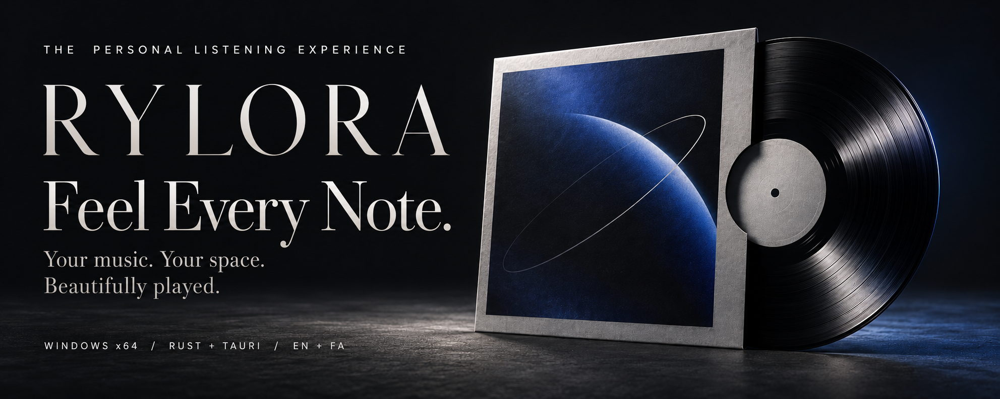
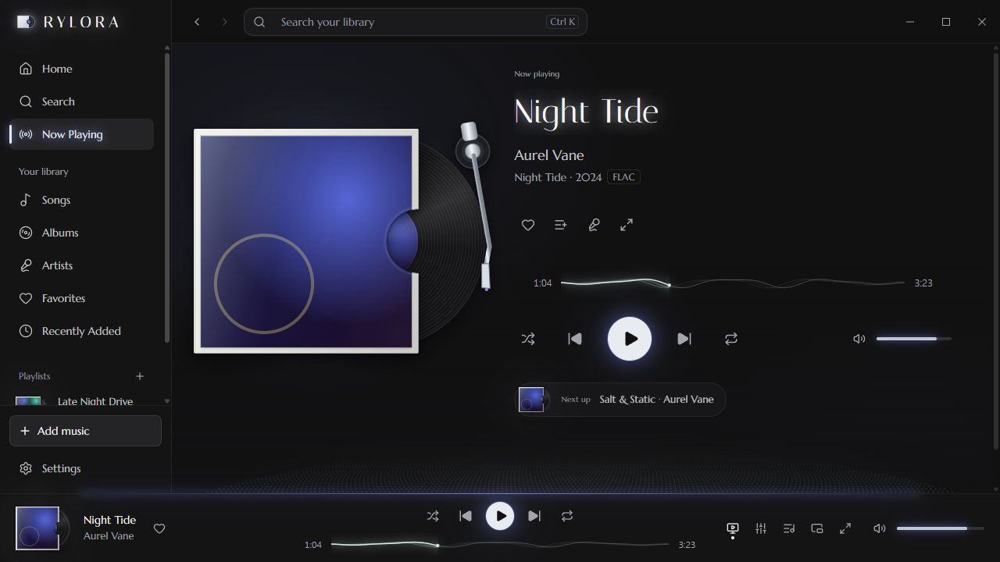
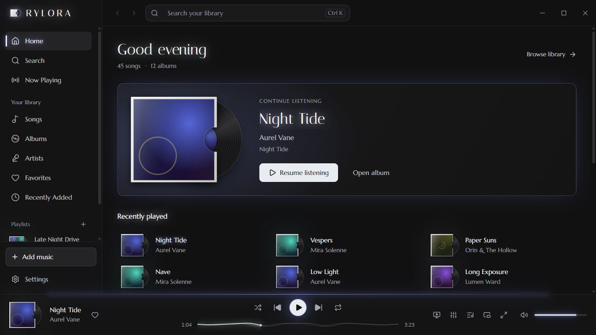
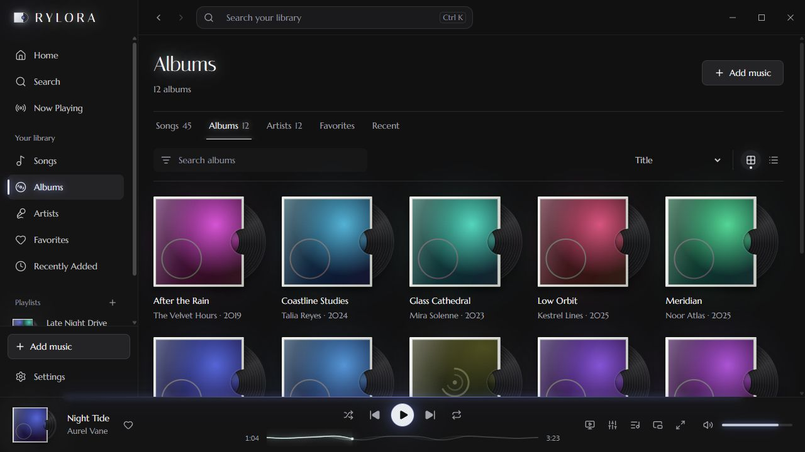
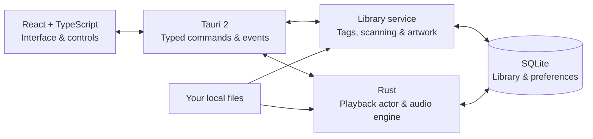

<div align="center">

[](https://github.com/karimialireza405/RYLORA/releases/latest)

# Your music. Beautifully played.

**RYLORA is a desktop listening room for the music you own.**

A record-inspired interface. A native Rust audio engine. A collection that stays yours.

[](https://github.com/karimialireza405/RYLORA/releases/tag/v0.1.0) [](https://github.com/karimialireza405/RYLORA/releases/latest) [](#native-where-it-matters) [](README.fa.md)

**English** &nbsp; / &nbsp; [**فارسی**](README.fa.md)

[](https://github.com/karimialireza405/RYLORA/releases/download/v0.1.0/RYLORA_0.1.0_x64-setup.exe)

[Release notes](https://github.com/karimialireza405/RYLORA/releases/tag/v0.1.0) &nbsp; · &nbsp; [Explore the interface](#a-listening-room-for-your-music) &nbsp; · &nbsp; [Run from source](#build-and-explore)

<sub>Windows x64 · Local music library · No account required for listening</sub>

</div>

---

## A listening room for your music

Some albums deserve more than a filename in a list. RYLORA turns your music folder into a record collection: sleeves you recognize, a place to pick up where you left off, and a player that takes its atmosphere from the cover on screen.

Import your files, choose a record, and settle in. Listening works offline; your music stays on your computer.



<p align="center"><sub>NOW PLAYING / A sleeve, a record, and room for the music.</sub></p>

> **Gallery note:** these are screenshots of the implemented interface, captured from the development browser preview with a fictional catalogue. The preview does not play audio or produce real FFT data. Native playback and audio-reactive behavior require the desktop app. The hero is original brand artwork. [Image sources and generation prompts →](docs/readme/README.md)

## Your collection. Your atmosphere.

<table>
<tr>
<td width="50%"></td>
<td width="50%"></td>
</tr>
<tr>
<td valign="top"><strong>A place to return to.</strong><br />Continue an album, revisit a recent listen, and keep favourite records close.</td>
<td valign="top"><strong>A library with character.</strong><br />Browse albums and artists, build playlists, and find the next track without leaving your collection.</td>
</tr>
</table>

<p align="center"><a href="docs/readme/home-fa.jpg">See the Persian interface →</a></p>

## The details make the difference

| For the collection | For the listening |
| :--- | :--- |
| **Files and folders.** Import recursively, scan in the background, and watch folders while RYLORA is open. | **An uninterrupted album.** Gapless transitions, an editable queue, shuffle, repeat, and playback-session resume. |
| **Artwork with presence.** Embedded covers and local sidecars become record sleeves, cached thumbnails, and the player's accent colours. | **Sound you can shape.** A ten-band EQ, presets, preamp, and remembered output-device selection. |
| **A library that remembers.** Favourites, playlists, pinned albums, play counts, and recent listening history. | **A more consistent level.** Track/album loudness normalization using ReplayGain tags or local EBU R128 analysis. |
| **Lyrics that follow along.** Local LRC, synchronized embedded lyrics, plain text, and click-to-seek for timed lines. | **Transitions on your terms.** Optional 1–12 second crossfade and silence skipping, with consecutive album tracks kept gapless by default. |
| **Persian, thoughtfully supported.** RTL layout, Persian digits, Solar Hijri dates, and an English interface one setting away. | **A player with atmosphere.** A native 64-band spectrum, cover-driven colour and motion, an immersive view, and a mini player. |

**Bring your files:** `MP3` · `FLAC` · `WAV` · `Ogg Vorbis` · `AAC / M4A`

<details>
<summary><strong>Desktop touches and keyboard controls</strong></summary>

Native file/folder pickers, file drops, single-instance handling, remembered window geometry, Windows media keys and media flyout, an always-on-top mini player, visible keyboard focus, and reduced-motion support are implemented.

| Action | Shortcut |
| :--- | :--- |
| Play / pause | `Space` |
| Next / previous | `Ctrl + → / ←` |
| Seek | `Shift + → / ←` |
| Volume | `Ctrl + ↑ / ↓` |
| Add music | `Ctrl + O` |
| Search | `Ctrl + K` or `/` |
| Queue | `Q` |
| Favourite | `Ctrl + L` |
| Shuffle / repeat | `S` / `R` |
| Immersive player | `F11` |
| Settings | `Ctrl + ,` |
| All shortcuts | `?` |

Inside the immersive player, use `F` for fullscreen, `L` for lyrics, and `Esc` to leave. Windows media keys use the native media-session integration.

</details>

## Your first listen

1. **Install RYLORA.** Download the [Windows x64 installer](https://github.com/karimialireza405/RYLORA/releases/download/v0.1.0/RYLORA_0.1.0_x64-setup.exe) and follow setup.
2. **Bring your collection.** Choose **Add music**, press **Ctrl + O**, or drop files and folders into the window. Folder imports include subfolders.
3. **Make it yours.** Select an album, choose your output device, adjust the EQ, or switch between Persian and English in Settings.

Importing adds to the library without interrupting playback. Choose **Play now** when you want to switch to a new selection.

| Download | Details |
| :--- | :--- |
| [**RYLORA 0.1.0 — installer**](https://github.com/karimialireza405/RYLORA/releases/download/v0.1.0/RYLORA_0.1.0_x64-setup.exe) | Windows x64 · 5.71 MiB |
| [**Release page**](https://github.com/karimialireza405/RYLORA/releases/tag/v0.1.0) | Published installer and release information |
| [**SHA256SUMS.txt**](https://github.com/karimialireza405/RYLORA/releases/download/v0.1.0/SHA256SUMS.txt) | Download-integrity verification |

**Installation note:** the installer is unsigned; Windows may show an unrecognized-publisher warning. Compare the download's SHA-256 with the checksum published in the same release. Windows 11 is the documented development and validation environment. Downloading from this public repository requires no repository invitation.

```powershell
Get-FileHash .\RYLORA_0.1.0_x64-setup.exe -Algorithm SHA256
```

## Native where it matters

React presents the collection. Rust owns the listening. A dedicated playback actor serializes commands and keeps the queue, audio transitions, and playback clock outside the UI. SQLite persists your library and listening data.



<details>
<summary><strong>Under the needle: audio, transitions, and visual response</strong></summary>

- **Gapless:** the next track is prepared before a transition; decoder delay/padding is handled while output remains continuous. Optional crossfade uses an equal-power blend.
- **Equalizer:** ten shelf/peaking bands at 31, 62, 125, 250, 500 Hz; 1, 2, 4, 8, and 16 kHz, plus preamp and presets.
- **Normalization:** ReplayGain tags take priority; otherwise local EBU R128 analysis supplies loudness measurements. Quiet, Normal, and Loud target −23, −14, and −11 LUFS. Gain is ramped and bounded by sample peaks; there is no limiter or true-peak guarantee. Without album tags, album normalization uses a duration-weighted energy estimate.
- **Output:** Windows shared-mode playback with device switching. Exclusive WASAPI and bit-perfect output are not implemented.
- **Visuals:** native FFT data drives a 64-band spectrum and smoothed cover response. Artwork supplies colour. The seek ribbon is a reactive visual control, not a decoded whole-track waveform. Reduced-motion preferences are respected.
- **Separation:** playback runs independently of React. A separate progress store receives approximately four updates per second; spectrum data travels outside React component state.

Read the [architecture](docs/architecture/overview.md) for ownership, thread boundaries, DSP, and event flow.

</details>

<details>
<summary><strong>A library that keeps its history</strong></summary>

Canonical path keys preserve identity across rescans. SQLite uses WAL and versioned migrations; scans run in the background with a separate database connection. Missing files are marked rather than silently deleting listening history.

Metadata edits are library-only by default. Explicit writes to music files use a verified sibling copy before replacing the original. Artwork prefers embedded images, then local sidecars such as `cover.jpg`, `folder.png`, `front.webp`, or an image with the song's filename. BLAKE3-addressed derivatives are cached at 640 and 192 pixels.

Folder watching runs while the application is open; a later scan reconciles changes made while it was closed. Lyrics are local; there is no online lyrics provider.

</details>

## Build and explore

The documented Windows toolchain uses **Node.js 24**, **Rust/MSVC**, **Visual Studio Build Tools with the C++ workload**, and **WebView2 Runtime**. The manifest declares Rust 1.82 as its minimum; the recorded development environment used Rust 1.95. See [development setup](docs/development/setup.md) for details.

```powershell
git clone https://github.com/karimialireza405/RYLORA.git
cd RYLORA
npm ci
npm run app:dev
```

| Task | Command |
| :--- | :--- |
| Type checks | `npm run typecheck` |
| Frontend tests | `npm test` |
| Rust tests | `cargo test --manifest-path src-tauri/Cargo.toml` |
| Rust lint | `cargo clippy --manifest-path src-tauri/Cargo.toml --all-targets` |
| Frontend production build | `npm run build` |
| Desktop installers | `npm run app:build` |
| NSIS installer only | `npm run tauri -- build --bundles nsis` |

Installer output is under `src-tauri/target/release/bundle/`. A frontend build does not establish playback compatibility with a real audio device. The [release guide](docs/development/releasing.md) covers packaging, code signing, and update manifests.

<details>
<summary><strong>Interface preview, test media, and source map</strong></summary>

`npm run dev` opens a development-only browser preview at `http://localhost:1420`. It supplies fictional tracks and deterministic artwork. **It does not decode audio, play sound, or generate real FFT data.** This preview backend is excluded from production builds.

Generate original synthesized test media with `python scripts/generate-test-media.py test-media`. It needs Python, NumPy, Pillow, and FFmpeg; import the generated folder into the desktop app.

```text
src/
├── app/                 Application shell and routing
├── features/            Library, player, settings, and other screens
├── components/          Shared controls, covers, and visualizations
├── services/backend/    Typed desktop interface and dev preview
├── stores/              UI state and backend snapshots
└── assets/              Brand and bundled fonts
src-tauri/src/
├── commands/            IPC adapters
├── application/         Player and library services
├── domain/              Models and queue rules
├── audio/               Decode, DSP, FFT, and output
├── library/             Paths, scanning, and watching
├── metadata/            Tags, covers, and colour
├── database/            Persistence and migrations
└── system/              Windows and artwork integration
scripts/                 Test media, releases, and signing
docs/                    Architecture, design, and development
```

Native calls stay behind `src/services/backend`; playback ownership stays in Rust. Validate Persian, Latin, and mixed-script text when changing the UI.

</details>

## Your files stay yours

Core listening needs no account, upload, or online music catalogue. There is no telemetry integration. Music remains in its original location; the library index, playlists, preferences, history, and artwork cache live in the application-data directory, normally `%APPDATA%\app.rylora.player\`.

Network activity belongs to the update flow when configured and requested or enabled. **No hosted update endpoint is configured in the checked-in application; this release is installed and updated manually.**

## Read the liner notes

| Guide | What is inside |
| :--- | :--- |
| [Architecture](docs/architecture/overview.md) | Playback ownership, threads, IPC, storage, and audio engineering |
| [Design system](docs/design-system/overview.md) | Typography, surfaces, artwork, colour, motion, and interaction |
| [Development setup](docs/development/setup.md) | Toolchain, local workflow, test media, and recorded checks |
| [Releasing](docs/development/releasing.md) | Installers, signatures, updates, and distribution |
| [Roadmap](docs/development/roadmap.md) | Implemented behavior, validation evidence, and remaining work |

<details>
<summary><strong>Project scope, formats, and licensing</strong></summary>

RYLORA 0.1.0 is an actively developed Windows desktop application. Streaming services, cloud sync, exclusive audio output, and a hosted update service are outside the current delivered configuration. Opus and chained Ogg streams that change sample rate mid-file are not supported.

The source repository is public. **No project-wide open-source license has been added**; public visibility does not grant a redistribution license. Dependencies retain their own licenses. [Italiana](docs/design-system/Italiana-OFL.txt) and [Marcellus](docs/design-system/Marcellus-OFL.txt) include OFL notices; Vazirmatn has its upstream OFL license. Peyda is proprietary; its [bundled notice](src/assets/fonts/peyda/FontLicense.txt) describes licensing requirements for redistribution.

Gallery captures and brand artwork are documented in [README assets](docs/readme/README.md). The banners are illustrative and do not depict a hardware product included with RYLORA.

</details>

---

<div align="center">


### RYLORA

*Feel Every Note.*

**Designed & developed by [Alireza Karimi](https://github.com/karimialireza405)**

<sub>Your records. Your space. Your sound.</sub>

[Download RYLORA](https://github.com/karimialireza405/RYLORA/releases/latest) &nbsp; · &nbsp; [فارسی](README.fa.md) &nbsp; · &nbsp; [GitHub](https://github.com/karimialireza405)

</div>
